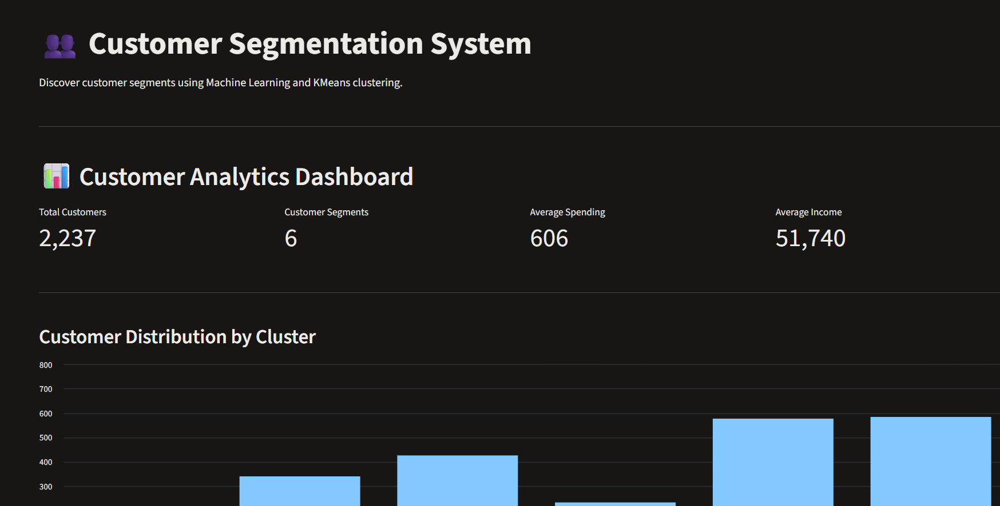
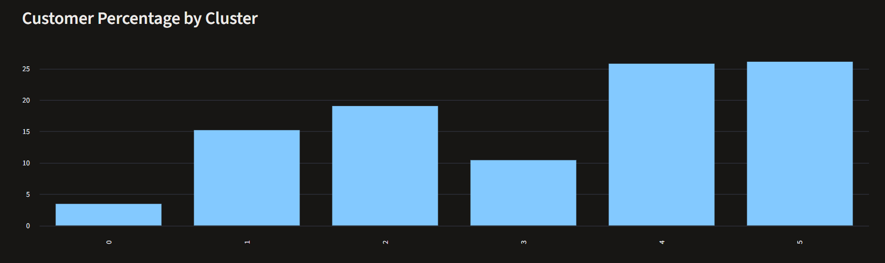
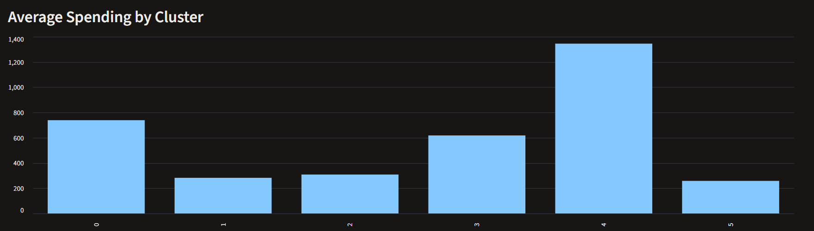
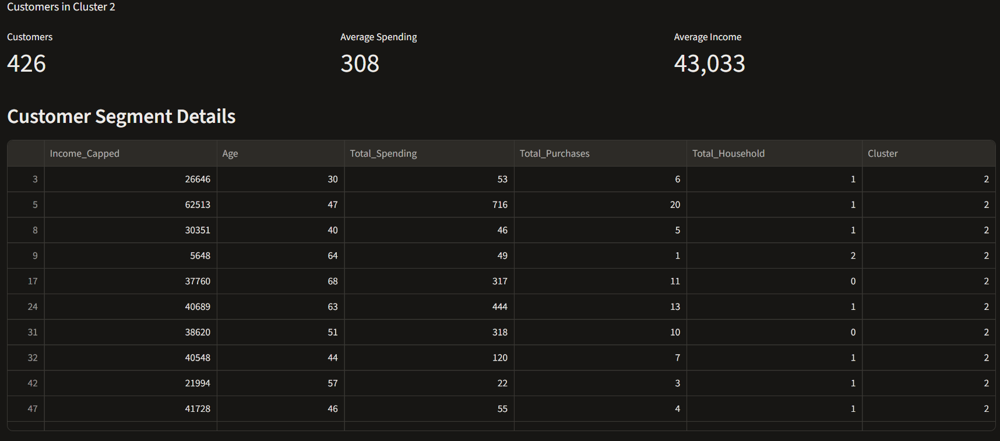
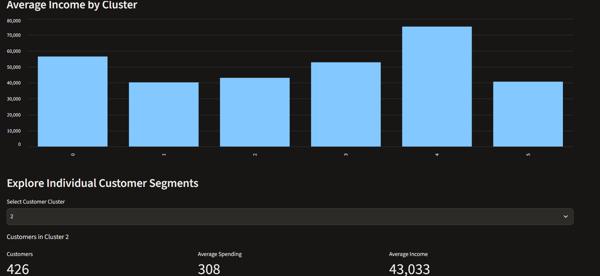
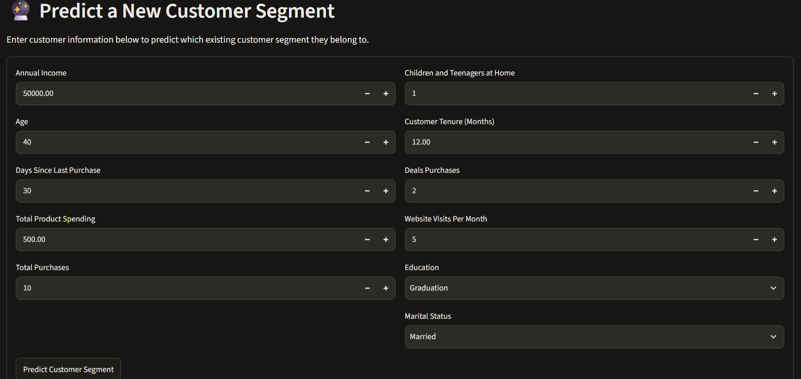
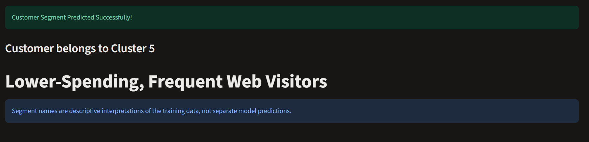

# Customer Segmentation Using Machine Learning

## Project Overview

This project uses Unsupervised Machine Learning to group customers based on their purchasing behaviour, income, demographics, and shopping activities.

The main objective is to help businesses understand different types of customers and make better marketing decisions.

## Technologies Used

- Python
- Pandas
- NumPy
- Matplotlib
- Seaborn
- Scikit-learn
- KMeans Clustering
- Streamlit
- Joblib

## Dataset

The project uses the Customer Personality Analysis dataset.

The dataset contains customer information such as:
- Income
- Age
- Education
- Marital Status
- Product Spending
- Purchase Behaviour
- Website Visits
- Promotional Purchases

## Project Workflow

1. Data loading and exploration
2. Data cleaning and preprocessing
3. Missing-value handling
4. Feature engineering
5. Categorical encoding
6. Feature scaling
7. KMeans clustering
8. Cluster evaluation and interpretation
9. Model saving
10. Streamlit application development

## Machine Learning Algorithm

**KMeans Clustering**

KMeans is an Unsupervised Machine Learning algorithm that groups similar customers into clusters.

The final model uses 6 clusters.

The choice considers both silhouette scores and the interpretability of customer groups. The clusters overlap to some extent, so the segments should be treated as exploratory customer profiles.

## Customer Segments

The project identifies six customer groups:

| Cluster | Segment Description |
|---|---|
| 0 | Older, Higher-Spending Customers |
| 1 | Lower-Spending Customers |
| 2 | Lower-to-Moderate Spending Customers |
| 3 | Moderate-to-High Spending Customers |
| 4 | High-Value Customers |
| 5 | Lower-Spending, Frequent Web Visitors |

These names are descriptive interpretations of the cluster profiles.

## Application Features

### 1. Customer Prediction
Enter customer information and predict which existing customer cluster they belong to.

### 2. Customer Analytics Dashboard
- Total customer count
- Number of customer segments
- Average customer income
- Average customer spending
- Customer distribution by cluster
- Cluster-wise spending and income comparisons
- Individual cluster exploration

## Project Structure

```text
Customer_Segmentation/
│
├── data/
│   └── marketing_campaign.csv
│
├── models/
│   ├── customer_segmentation_kmeans.pkl
│   ├── customer_scaler.pkl
│   ├── customer_imputer.pkl
│   ├── customer_feature_columns.pkl
│   └── customer_segments.csv
│
├── main.py
├── app.py
└── README.md
```

## How to Run the Project

### Step 1: Clone the repository

```bash
git clone YOUR_GITHUB_REPOSITORY_URL
```

### Step 2: Navigate to the project folder

```bash
cd Customer_Segmentation
```

### Step 3: Install dependencies

```bash
pip install pandas numpy matplotlib seaborn scikit-learn streamlit joblib
```

### Step 4: Run the Streamlit application

```bash
python -m streamlit run app.py
```

The application will open in your browser.

## Future Improvements

- More advanced clustering evaluation
- Additional customer behaviour insights
- Improved interactive visualizations
- More detailed business recommendations

---

## 👥 Customer Segments and Business Insights

Our KMeans clustering model divides customers into six groups
based on their purchasing behaviour, income, demographics,
and shopping patterns.

| Cluster | Customer Segment | Business Insight |
|---|---|---|
| 0 | Older, Higher-Spending Customers | Consider loyalty programs and personalized offers. |
| 1 | Lower-Spending Customers | Explore affordable product recommendations and introductory offers. |
| 2 | Lower-to-Moderate Spending Customers | Encourage repeat purchases through relevant promotions. |
| 3 | Moderate-to-High Spending Customers | Promote complementary products and customer retention campaigns. |
| 4 | High-Value Customers | Focus on premium services, exclusive offers, and loyalty rewards. |
| 5 | Lower-Spending, Frequent Web Visitors | Improve online engagement and provide relevant product recommendations. |

### Key Business Benefits

- Identify valuable customer groups.
- Understand differences in customer purchasing behaviour.
- Design targeted marketing campaigns.
- Improve customer engagement and retention.
- Support data-driven business decisions.

**Note:** These segment names are descriptive interpretations
of the cluster profiles, not labels provided by the original dataset.
KMeans is an exploratory clustering model, so customers within
different clusters may still have overlapping characteristics.

## Conclusion

This project demonstrates how Unsupervised Machine Learning can be used to discover customer groups and explore purchasing behaviour through an interactive web application.

## 📸 Project Screenshots

### 1. Dashboard Overview


### 2. Customer Cluster Distribution


### 3. Customer Spending Analysis


### 4. Customer Income Analysis


### 5. Cluster Profile


### 6. Customer Prediction Interface


### 7. Prediction Result
